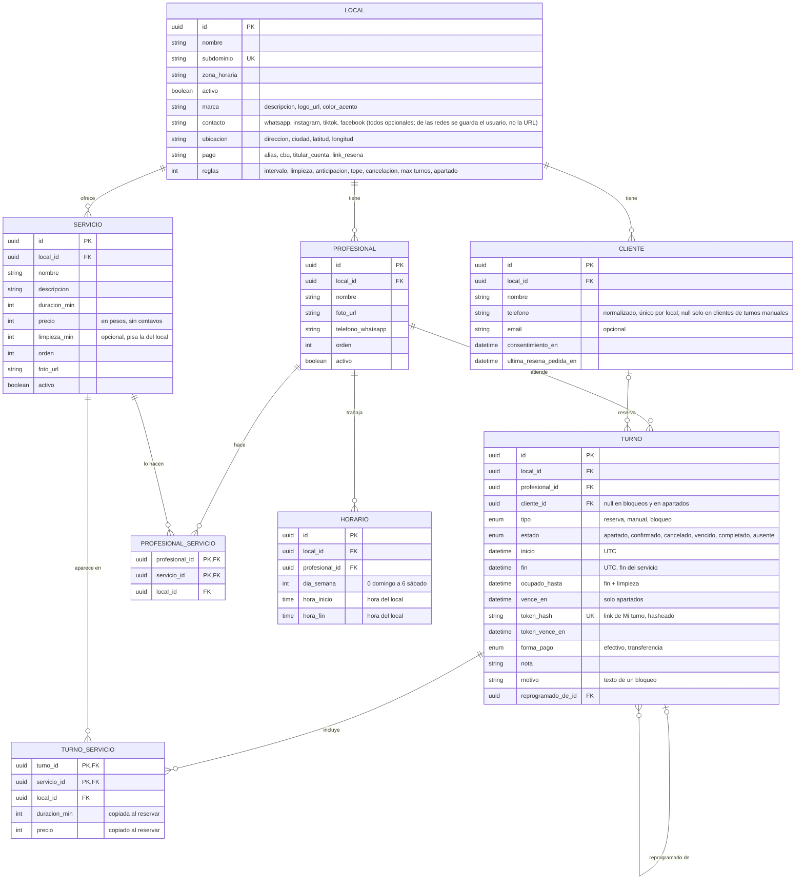

# Modelo de datos

Modelo acordado para la v1 (diseñado el 2026-10-05 en la versión TypeScript y conservado al pasar a Java + Spring Boot). La fuente de verdad del código van a ser las migraciones SQL de Flyway: las tablas, claves y reglas se escriben a mano en SQL, y las entidades JPA se validan contra ese esquema (`spring.jpa.hibernate.ddl-auto=validate`), nunca al revés.

Mapeo JPA (2026-10-27): las relaciones se guardan como ids simples (`UUID localId`, `UUID profesionalId`), sin `@ManyToOne`, porque las claves foráneas compuestas comparten la columna `local_id` y Hibernate no las mapea bien; la integridad entre locales la garantiza la base. Cada entidad mapea solo las columnas que usa la etapa en curso y suma las demás cuando se necesitan.

## Valores por defecto de las reglas del local (doc 01 §3.3)

| Columna                | Default | Qué es                                            |
| ---------------------- | ------- | ------------------------------------------------- |
| `intervalo_min`        | 15      | Cada cuánto se ofrece un horario de inicio        |
| `limpieza_min`         | 0       | Minutos libres después de cada turno              |
| `anticipacion_min`     | 60      | No se puede reservar para dentro de menos de esto |
| `tope_dias`            | 30      | Hasta cuántos días hacia adelante se reserva      |
| `cancelar_hasta_horas` | 3       | Hasta cuándo se cancela o reprograma sin llamar   |
| `max_turnos_futuros`   | 2       | Turnos futuros por teléfono                       |
| `apartado_min`         | 5       | Cuánto dura el apartado del horario               |

## Reglas que el diagrama no muestra

- **Turnos que no se pisan:** un profesional no puede tener dos filas de `turno` cuyos rangos `[inicio, ocupado_hasta)` se crucen, salvo que estén `cancelado` o `vencido`. Lo garantiza PostgreSQL con un constraint de exclusión (`btree_gist`), no el código. El rango es semiabierto: 10:00–10:45 y 10:45–11:30 no se pisan. Las columnas son `timestamptz` y el rango es `tstzrange` (no `tsrange` sobre `timestamp` sin zona). La extensión `btree_gist` la crea la primera migración, no un script de Docker, para que exista también en la base de tests y en producción.
- **Bloqueos y apartados en la misma tabla:** un constraint de exclusión mira una sola tabla, así que los bloqueos (feriados, vacaciones, "el jueves salgo a las 18") son filas de `turno` con `tipo = 'bloqueo'` y sin cliente, y la reserva en curso es una fila con `estado = 'apartado'` y `vence_en`. Así los dos pasan por la misma regla que los turnos. Un bloqueo de todo el local es una fila por profesional, en una transacción.
- **Apartados vencidos:** el constraint no puede depender de `now()`, así que un apartado vencido que sigue figurando como `apartado` todavía bloquea. La transacción que reserva primero pasa a `vencido` los apartados vencidos que se cruzan con el horario pedido y después inserta; si dos lo hacen a la vez, el constraint deja entrar a uno solo. El cálculo de horas libres trata como libre a un apartado vencido. Confirmar es un `UPDATE` de la misma fila (`apartado → confirmado`). Un trabajo programado limpia los viejos (Etapa 8).
- **Limpieza:** `ocupado_hasta = fin + limpieza` lo calcula la API, porque un índice no puede sumar intervalos a fechas con zona.
- **Integridad entre locales:** profesional, servicio, cliente y turno tienen un único `(local_id, id)`, y todas las relaciones entre ellos usan claves foráneas compuestas `(local_id, x_id)`. La base rechaza un turno del local A con un profesional, cliente o servicio del local B, aunque la API tenga un bug. Esta es la regla de seguridad más importante del multi-tenant.
- **Horarios:** dos franjas del mismo profesional y día no se pueden pisar (otro constraint de exclusión) y el fin tiene que ser posterior al inicio. Una pausa son dos franjas. En la versión TypeScript se guardaban en minutos desde la medianoche porque Prisma maneja mal el tipo `time`; con JPA, `time` se mapea limpio a `LocalTime`, así que se usa `time`, con un tipo rango propio (`rango_hora`) para el constraint de exclusión, porque Postgres no trae uno para `time`. (Confirmado 2026-10-14)
- **Coherencia del turno (CHECK):** `fin > inicio`, `ocupado_hasta >= fin`, todo apartado tiene `vence_en`, un bloqueo nunca tiene cliente, y una reserva o turno manual tiene cliente salvo mientras está `apartado`. El apartado se crea al llegar al paso de datos, antes de conocer al cliente; el `UPDATE` que lo confirma completa el `cliente_id`. (2026-10-12)
- **Valores válidos (CHECK):** subdominio en minúsculas, color en `#rrggbb`, duración del servicio entre 5 y 480 minutos, precio no negativo y reglas del local dentro de rangos razonables.
- **Cliente único por local:** no puede haber dos clientes con el mismo `telefono` en el mismo local (`UNIQUE (local_id, telefono)`; Postgres permite varios nulos). El teléfono se normaliza a formato internacional (`+549...`) antes de guardarlo, para que `11 2345-6789` y `+54 9 11 2345-6789` sean el mismo cliente. El teléfono es obligatorio en toda reserva web (lo valida la API: la regla cruza `turno` y `cliente`, así que no puede ser un CHECK) y opcional solo en los turnos manuales del panel (HU-28). (2026-10-12)
- **Visitas y faltas:** no se guardan como contador. Se calculan contando los turnos `completado` y `ausente` del cliente, igual que los horarios libres se calculan desde la agenda: una sola fuente de verdad. (2026-10-12)
- **Máximo de turnos futuros por teléfono:** lo chequea la API dentro de la transacción de reserva, bloqueando la fila del cliente (`SELECT … FOR UPDATE`) antes de contar, para que dos reservas simultáneas del mismo teléfono no pasen las dos.
- **Precio y duración copiados:** `turno_servicio` guarda la duración y el precio del momento de la reserva. Cambiar un servicio solo afecta a turnos nuevos.
- **Token del turno:** se guarda solo el hash (nunca el token en texto plano) y tiene vencimiento. Si se filtra la base, no se filtran los links.
- **Fechas:** los turnos se guardan en UTC (`timestamptz`, `Instant` en Java) y los horarios de trabajo en hora del local. Todo se muestra en hora del local, con la zona fija del local (`America/Argentina/Buenos_Aires`).

## Tablas que se agregan en su etapa

Para no crear tablas que nadie usa todavía, cada una entra con su migración en la etapa que la necesita:

| Tabla                             | Para qué                                                           | Etapa |
| --------------------------------- | ------------------------------------------------------------------ | ----- |
| `usuario` y tablas de sesión      | Login del panel (argon2id, sesiones guardadas en Postgres)          | 5     |
| `codigo_verificacion`             | Código por teléfono para volver a entrar (hasheado, con intentos)  | 6     |
| `mensaje`                         | Mensajes al cliente con estado de entrega y clave única (no duplicar) | 8     |
| `notificacion`                    | Avisos al profesional en el panel                                  | 8     |

## Datos de demostración

Local `demo` (zona `America/Argentina/Buenos_Aires`): 4 servicios activos y 1 oculto, 2 profesionales (Ana y Bruno), horario de martes a sábado de 10 a 13 y de 16 a 20, intervalo de 15 minutos, anticipación mínima 1 h, tope 30 días. Un segundo local, `otra`, sirve para probar el aislamiento entre locales.
