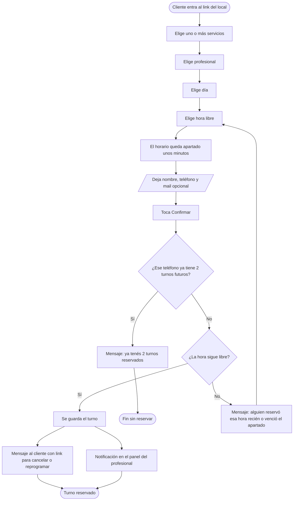

# Flujo de reserva del cliente

En la v1 el mensaje al cliente sale por un adaptador simulado; el envío real por WhatsApp queda preparado pero apagado. La pantalla de confirmación muestra el link de "Mi turno".
