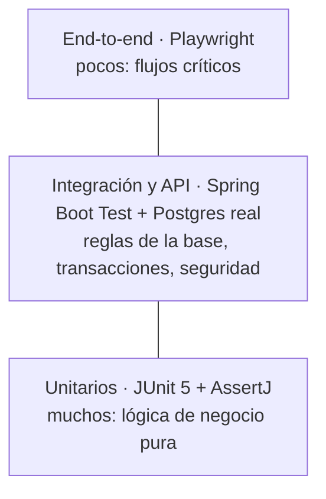

# Slotly · Estrategia de testing

Cómo se testea Slotly: qué se prueba en cada nivel, con qué herramienta, qué se automatiza y qué se prueba a mano. Las pruebas manuales y los bugs están en `07-plan-de-pruebas.md`.

## 1. La pirámide en Slotly

Muchos tests baratos y precisos abajo, pocos caros y realistas arriba. Cuanto más arriba, más lento, más frágil y menos preciso cuando falla.

| Nivel | Herramienta | Qué se prueba en Slotly |
| --- | --- | --- |
| Unitario | JUnit 5 + AssertJ, sin Spring ni base | Motor de horarios libres, totales de tiempo y precio, normalización de teléfonos, plazos para cancelar o reprogramar, cálculo de `ocupado_hasta` |
| Integración | `@SpringBootTest` + Testcontainers (Postgres 17 real) | Constraint de exclusión, claves compuestas multi-tenant, CHECKs, transacciones (máximo de turnos con `FOR UPDATE`), concurrencia, aislamiento entre locales, migraciones de Flyway |
| API (slice) | `@WebMvcTest` + MockMvc + Mockito | Cómo responde cada controlador: códigos HTTP, JSON, validación, `ProblemDetail` con `codigo` |
| API (completa) | `@SpringBootTest` + MockMvc + Postgres real | Endpoints con la base y la seguridad reales: permisos por rol, sesión, 404 entre locales |
| Componente (front) | Vitest + Testing Library | Pantallas y formularios: selección de servicios, saltar el paso 2, validaciones, estados de carga y error |
| End-to-end | Playwright | Flujos críticos con todo levantado: reservar un turno, horario ocupado, login del panel, Mi turno |
| Manual | `docs/07` | Lo visual, el uso en celular, la usabilidad y las sesiones exploratorias |

## 2. Qué es un buen test

- **Nombre claro:** se entiende qué comportamiento verifica sin leer el código.
- **Un solo motivo para fallar:** si falla, se sabe qué se rompió.
- **Preparar → actuar → verificar**, separados por una línea vacía.
- **Independiente:** no depende de otro test ni del orden en que corren.
- **Repetible:** da el mismo resultado en cualquier máquina y a cualquier hora.
- **Lo vimos fallar:** cada test nuevo se hace fallar a propósito una vez. Un test que nunca falló puede ser un falso positivo.

## 3. Reglas del proyecto

- **Nombres:** la clase de test se llama como la clase probada más `Test` (`HealthControllerTest`). El método describe el comportamiento en castellano (`responde503CuandoLaBaseNoResponde`).
- **Trazabilidad:** todo test que cubre un criterio lleva `@DisplayName("HU-07 CA1: ...")`. Los de infraestructura, `@DisplayName("Etapa 0: ...")`.
- **Datos:** cada test arma sus propios datos con métodos auxiliares o builders. Nada de datos compartidos entre tests.
- **Base limpia:** los tests de integración vacían las tablas de negocio con `TRUNCATE` antes de cada test. No se usa rollback: el test de concurrencia necesita transacciones reales que hagan commit.
- **Reloj controlado:** la lógica nunca llama a `Instant.now()`; recibe un `Clock` inyectado. Los tests usan `Clock.fixed(...)`.
- **Sin esperas fijas:** nada de `Thread.sleep`. Se espera por condición (`CountDownLatch` en concurrencia, la espera automática de Playwright en e2e).
- **Mocks:** sí para aislar la capa web (`@WebMvcTest`) o un adaptador externo (el notificador). **Nunca** para la base en los tests del constraint, las transacciones o el aislamiento entre locales: un mock haría lo que le programamos, no lo que hace Postgres.
- **Un solo contenedor por corrida:** Spring reutiliza el contexto entre tests solo si su configuración es idéntica. Los tests de integración usan todos la misma anotación compartida (`@IntegrationTest`, que junta `@SpringBootTest`, `@AutoConfigureMockMvc` y la configuración de Testcontainers), así comparten contexto y contenedor.
- **Seguridad de primera clase:** cada endpoint se prueba sin sesión, con el rol equivocado, con un ID de otro local (espera 404), con datos inválidos y, si corresponde, con rate limiting y sin token CSRF.

## 4. Qué se automatiza y qué se prueba a mano

- **Automático:** toda regla de negocio, toda regla de la base, toda respuesta de la API (feliz, error y permisos) y los flujos críticos de punta a punta.
- **Manual (`docs/07`):** aspecto visual, uso en un celular real, accesibilidad básica, mensajes y textos, y sesiones exploratorias de 15 a 20 minutos por etapa. Un smoke test de 5 a 8 minutos con los flujos críticos se actualiza en cada etapa.

## 5. Cobertura

JaCoCo genera el reporte en cada corrida. Se mira sobre todo la lógica de negocio (motor de horarios, reglas de turnos). No se persigue el 100 %: un número alto con tests sin verificaciones no prueba nada. El umbral mínimo se decide en la Etapa 3, cuando exista el motor.

## 6. Trazabilidad

Al cerrar cada etapa se arma la matriz:

| Historia | Criterio | Test automático | Caso manual | Estado |
| --- | --- | --- | --- | --- |

Ninguna historia pasa a "Hecha" si algún criterio queda sin un test automático o sin un caso manual ejecutado.

## 7. En CI (GitHub Actions)

En cada push y pull request:
- **Back:** `./mvnw verify` (los tests de integración usan Docker, que ya viene en los runners de GitHub).
- **Front:** `npm ci`, lint, tests y build.
- **End-to-end:** se suman en la Etapa 4.

## 8. Decisiones y trade-offs

- **Testcontainers en vez de la base del docker-compose** (D4): cada corrida arranca limpia e igual en local y en CI. A cambio tarda unos segundos más.
- **La versión de Postgres está escrita en dos lugares**, `docker-compose.yml` y `TestcontainersConfiguration`. Si se cambia, se cambian juntas.
- **Tests de componente del front:** el `fetch` se reemplaza con funciones simuladas de Vitest. Si los tests crecen, la evolución es MSW (otra dependencia, a decidir en su momento).
